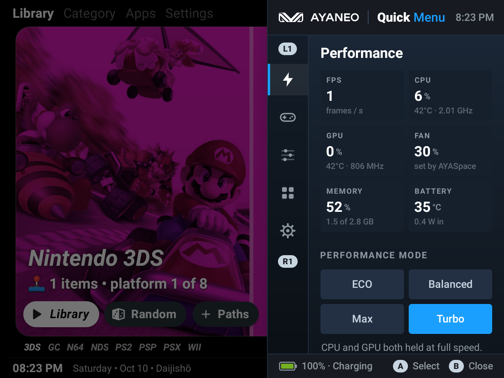
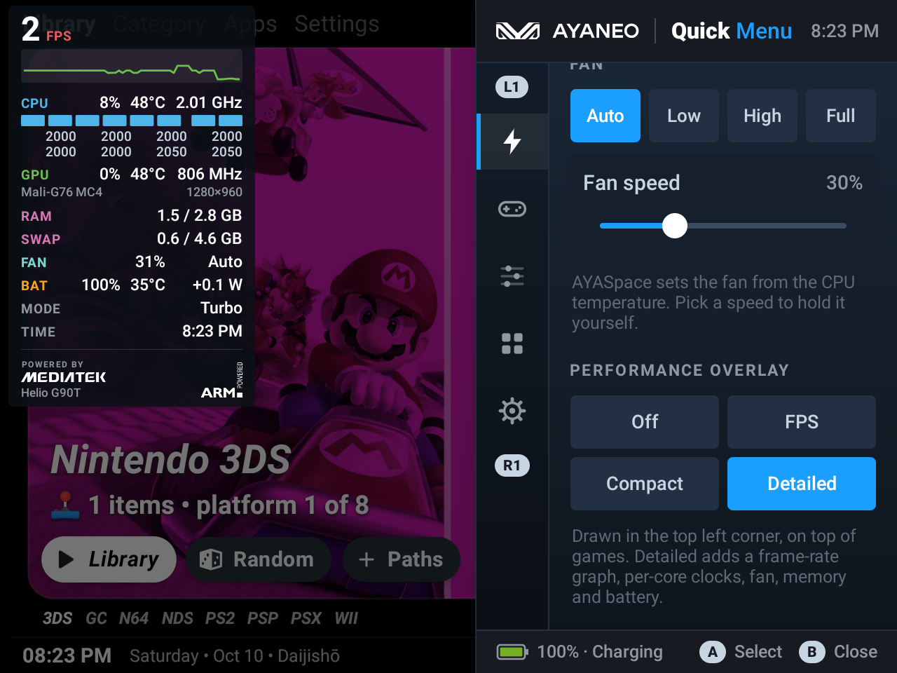
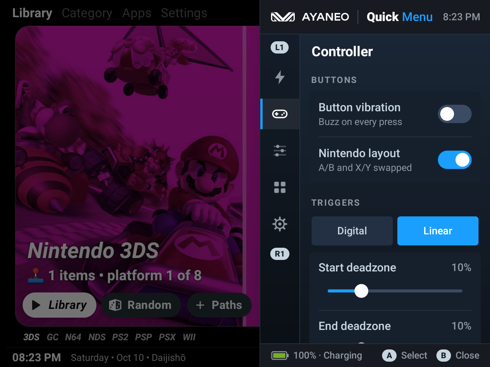
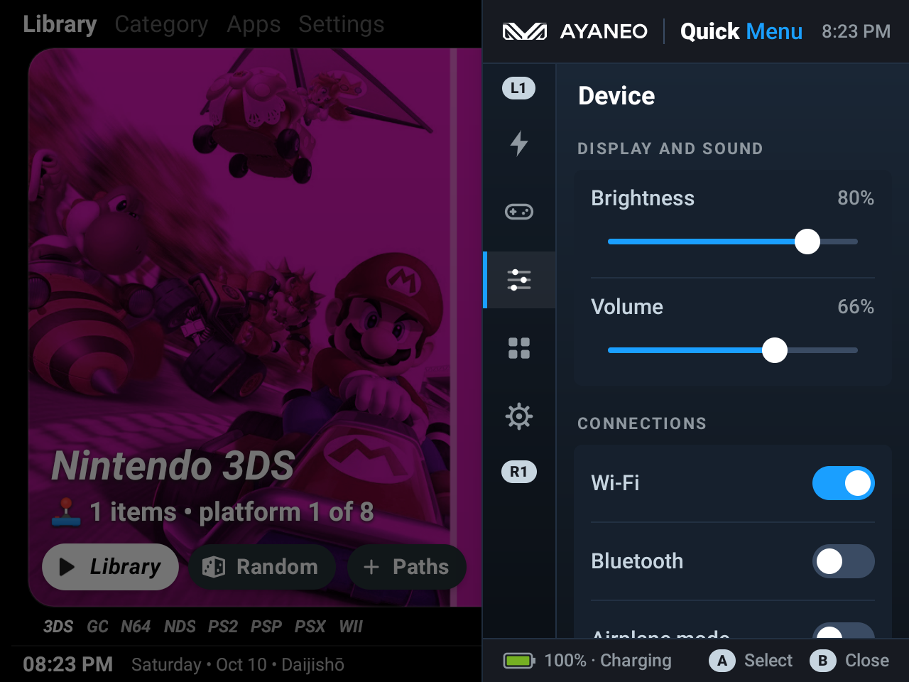
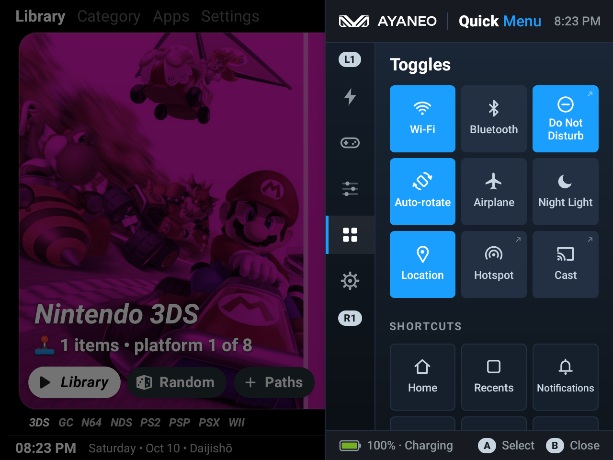
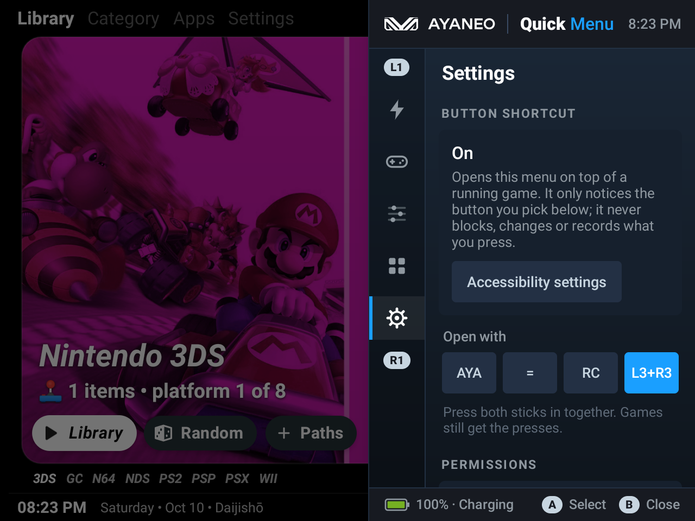
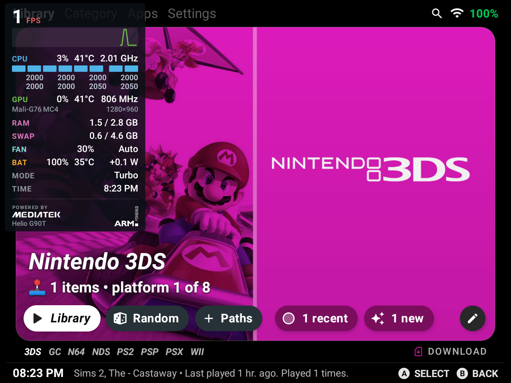
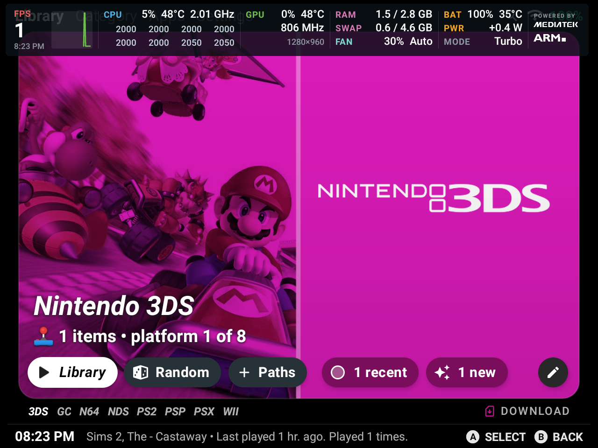

# AYANEO Quick Menu

**A Steam Deck-style quick menu for the AYANEO Pocket Air Mini.** Press a button over any game to change the performance mode, set the fan, tune the controller, flip quick toggles or switch on a detailed performance overlay. It's an unofficial rebuild of the quick menu in AYASpace, and the companion to **[AYANEO RGB Control](https://github.com/intelarc/ayaneo-rgb-control)** (formerly RGB+), which controls the stick lights.

> **Unofficial.** AYANEO Quick Menu is a fan-made app. It is not made by, endorsed by or affiliated with AYANEO, MediaTek or Arm; their names and logos belong to them.



## Download

**[⬇ Download AYANEO-Quick-Menu.apk (latest)](https://github.com/intelarc/ayaneo-quick-menu/releases/latest/download/AYANEO-Quick-Menu.apk)** · [All releases](https://github.com/intelarc/ayaneo-quick-menu/releases)

Built and tested on one device: the AYANEO Pocket Air Mini (Android 11, firmware MP40AY2-20251125, AYASpace 1.0.84). It talks to AYANEO's own firmware service, so it is unlikely to work on anything else.

## Install on the AYANEO Pocket Air Mini

1. Open the download link above in the device's browser and download the APK.
2. Open the downloaded file. If Android asks, allow your browser (or file manager) to **install unknown apps**, then go back and tap **Install**.
3. Open **AYANEO Quick Menu** from the launcher. It works straight away as its own screen.
4. To open it over a running game: **Settings → Button shortcut → Turn on**, then switch on **Quick Menu – button shortcut** in Android's Accessibility settings. Press **L3 + R3** (both sticks in) to open and close the menu.
5. For the brightness slider and auto-rotate: **Settings → Permissions → System settings → Allow**.

From a PC instead, with USB debugging on:

```
adb install AYANEO-Quick-Menu.apk
```

## Features

- **Performance modes that do something.** ECO caps the CPU at about 60%, Balanced lets it follow the load, Max holds it at full speed, Turbo also holds the GPU at full speed. (AYASpace's own modes all keep the CPU pinned at full speed on this device.)
- **Fan control.** Auto, Low, High, Full or any speed on a slider, and it stays where you put it.
- **Live readings:** frame rate, CPU load, temperature and clock, GPU load and clock, fan, memory, battery temperature and power draw.
- **Performance overlay** in three sizes: FPS only, a compact line, or a detailed readout with a frame-rate graph, every core's clock, GPU, memory, swap, fan, battery, mode and time. Tap the detailed one to flip it between a panel and a strip along the top.
- **Controller:** button vibration, Nintendo or Xbox button layout, digital or linear triggers, trigger and stick deadzones, right stick as D-pad, D-pad as left stick. The page shows the firmware's live values.
- **Device:** brightness, volume, Wi-Fi, Bluetooth, airplane mode, and a shortcut to RGB Control.
- **Toggles:** Wi-Fi, Bluetooth, Do Not Disturb, auto-rotate, airplane mode, Night Light, location, plus shortcuts for Home, Recents, Notifications, Screenshot, Power menu and Lock.
- **Open it with** L3 + R3, the AYA button, `=` or RC. With the AYA button, AYASpace's own menu still opens, underneath this one, and closes with it.
- **Made for the controller:** D-pad focus everywhere, L1 / R1 switch pages, A selects, B closes. Touch works too. Sized for the 640 × 480 dp screen.
- **Light:** nothing runs while the menu is closed and the overlay is off.

## Screenshots

| | |
| --- | --- |
|  |  |
|  |  |
|  |  |
|  |  |

## How it works

| Part | Goes through |
| --- | --- |
| Performance modes | the firmware's `custom_function` service: `setCpuSchedulingMode`, `setCpuFreqLimit`, `setGpuFrequency` |
| Controller settings | the same service's setters; the live values are read back from its `persist.*` properties |
| Fan | a flat curve written into AYASpace's own fan-curve files (root helper) |
| CPU load and temperatures | root helper |
| Airplane, Night Light, Location, Do Not Disturb | root helper; without it these tiles open the matching settings screen |
| Brightness, volume, Wi-Fi, Bluetooth, auto-rotate | ordinary Android APIs |
| Opening over games, the overlay, Recents / Screenshot / Power menu / Lock | the accessibility service |

"Firmware" is the hidden `custom_function` system service (`android.app.customfunction.CustomFunctionManager`) that AYANEO added to Android, the one AYASpace itself uses.

### The root helper

That service runs any script an app hands it through an init service (`myroot`: user root, SELinux domain `shell`). The menu uses it only for the rows marked above, with short fixed scripts started by a press, plus one read every few seconds while the Performance page or the detailed overlay is showing. **Settings → Permissions → Root helper** switches it off; the fan is handed back to AYASpace first.

### The accessibility service

It watches for the button you picked and nothing else, and never consumes input: games still get every press. RC is the exception worth knowing: AYASpace treats RC as Back, so the menu swallows the Back that AYASpace sends 0.4 s after each RC press.

## Findings from the firmware

For anyone else poking at this device (BW02 / MT6785):

- **The fan belongs to AYASpace, but its curves are files.** Its `AutoFanWorker` wakes every 5 seconds, reads the curve of its current fan mode from `/sdcard/.aya/aya_fan_mode_{low,high,max,config}_v4.conf` (`duty,temperature|duty,temperature|...`) and sets the fan from the CPU temperature, so a speed written straight to the firmware is gone within seconds. A flat curve in those files (`60,0|60,100`) is kept; a missing or empty file means AYASpace's built-in curve. While AYASpace's own fan mode is Off it holds the fan off whatever the files say.
- **AYASpace keeps the CPU at full speed in every mode.** All of its performance modes pass the maximum frequencies to `setCpuFreqLimit`, which fixes MediaTek's `ut_fix_freq_idx` to them. Here, Max does the same, Balanced clears the fix (the governor scales 0.5 to 2.0 GHz), ECO caps both clusters at about 60%, and Turbo also fixes the GPU at the top of its table (806 MHz), which is what AYASpace's own "Max" does.
- **No real overclock from an app.** GammaOS runs this GPU at 950 MHz through its own kernel. On the stock kernel the table ends at 806 MHz, and `/proc/gpufreq/gpufreq_fixed_freq_volt`, which could go past it, is closed to the `shell` SELinux domain, so not even the root helper reaches it.
- Every controller setting is mirrored in a `persist.*` property (`persist.ljoyDMR.value`, `persist.Lefttristartzone.value`, `persist.rjoytodpad.value`, ...). AYASpace keeps its own copies under `ayaneo/share/...` in `Settings.System` and in `/sdcard/.aya/*.conf`; the menu updates those too so they survive a restart.
- `getFanSpeed` returns the last duty written (`persist.fan.speed`), not an RPM. AYASpace's RPM figure is derived from it.
- Thermal zones and `/proc/stat` are closed to apps but open to the root helper (`dumpsys hardware_properties`, `head -1 /proc/stat`). The fan's own sysfs files are closed to both.
- The frame rate is published by the firmware in the `com.ayaneo.fps` system property.
- `targetSdk` is 28 on purpose: Android only lets apps targeting 9 or lower switch Wi-Fi directly.

## Build from source

Kotlin, no AndroidX, Gradle wrapper included. With a JDK 21 and the Android SDK:

```
gradlew assembleDebug
```

`build-debug.cmd` and `build-release.cmd` do the same with the toolchain paths this project was developed with. The release build is signed with a keystore that is not in the repository.

For testing: `adb shell am start -n com.rgbplus.ayaneo.quickmenu/com.ayaquick.PanelActivity --es test page --es p toggles` opens a page. `adb shell input keyevent` does not reach accessibility services; to press AYA or L3 + R3 for real, register a virtual gamepad with `adb shell hid <file>` (button usage 67 is the AYA key, 14 and 15 are L3 and R3). `uiautomator dump` suspends accessibility services while it runs, which closes the overlay.

## Related

- **[AYANEO RGB Control](https://github.com/intelarc/ayaneo-rgb-control)** (formerly RGB+): 52 effects and 48 themes for the stick lights of the same handheld. Quick Menu borrows its design system and links to it from the Device and Settings pages.

## Disclaimer

Use at your own risk. This app changes how the CPU, GPU and fan run. A fan held at a low speed stays there however hot the device gets (Android's own thermal limits still apply); pick **Auto** to hand it back to AYASpace.

## License

The code is under the [MIT](LICENSE) license. The AYANEO, MediaTek and Arm names and logos are trademarks of their owners and are not covered by it.
